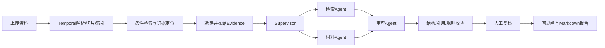

# 膜构智审 · Engineering Document Review

把工程资料入库、条件检索、材料核验与人工复核接成可追溯的审查流程。面向膜结构项目的设计、采购和审核人员，输出带原文位置的问题单。

**个人工程复现** · 三个子 Agent 封装为工具 · 真实 Temporal 开发服务故障验收 · Docker Compose 部署包

当前可运行演示为 **SQLite / Fake Agent / Basic TXT + 真实 Temporal 开发 Server**。PostgreSQL/pgvector完整栈及新强弱模型组合仍待验收；本项目不签发结构安全或材料合格结论。

## 从哪里开始

| 目标 | 入口 |
| --- | --- |
| 先理解一条完整业务 | 下方业务流程与[业务范围](docs/business-boundaries.md) |
| 启动或部署 | [Docker Compose部署](docs/deployment.md)、[本地运行](docs/operator-runbook.md) |
| 核查实测结果 | [当前验证](docs/current-validation.md)、[安全验证摘要](docs/validation-artifacts/README.md) |
| 阅读代码与接口 | [架构](docs/architecture.md)、[代码导览](docs/code-map.md)、[前后端合同](docs/frontend-contract.md) |
| 了解方案取舍 | [Agent与RAG设计说明](docs/implementation-and-interview-2026-11-03.md)、[评测协议](docs/evaluation-protocol.md) |

## 一条完整业务

工程师上传设计要求、材料规格及安装说明，等待解析与索引完成，再声明型号、适用版次、生效日期及依据。资料检索返回带定位的候选，用户选定资料后提交审查，系统冻结本次Evidence。

Supervisor组织检索与材料Agent取证，再由审查Agent核对原文、缺项和跨文档差异。结构、引文、规则与覆盖检查完成后，审核人处理问题并批准或退回；旧版本更新返回409。历史价格按任务需要选入。



## 主要实现

| 模块 | 实现与边界 |
| --- | --- |
| Agent工具化 | `review_retrieval`、`review_material`、`review_review`由LangChain Supervisor调用；身份和资料范围由服务端绑定。Temporal用确定性Workflow保证依赖 |
| 模型分工 | Supervisor/审查共用STRONG配置，检索/材料共用LIGHT配置；模型名可配置，API失败不切Fake |
| 项目资料检索 | PostgreSQL型号/版次/日期条件，pgvector向量候选，weighted RRF与可选Reranker；词项通道当前为substring计分 |
| 审查取证 | 子Agent只查已授权的冻结包，使用snapshot_lexical工具；补证需重新选资料提交，避免版本漂移 |
| 业务规则 | 同对象/适用版本的厚度及面密度单位归一，资料缺项、引用与历史价格口径检查；复杂表格和容差由人工判断 |
| 人工复核 | 问题处理、报告版本锁、持久审批命令；Signal只唤醒，Activity幂等消费决定 |
| 长任务 | Temporal负责解析、索引和审查，包含重试、取消、Heartbeat、执行认领及旧attempt写入围栏 |
| 外部与前端 | MCP对外提供能力，REST/MCP复用应用服务；Vue工作台调用REST/SSE，鉴权下载资料与报告MD |

Contextual Retrieval首版`metadata-v1`只补文件、章节、工作表和位置，默认关闭；开启会改变向量命名空间并要求重建。保留原件及Evidence权威，Markdown是派生阅读格式，生成报告不自动成为检索源。

## 快速开始

在装有Docker Engine、Compose v2与Python的机器执行：

```bash
python3 scripts/init_deployment.py
docker compose --env-file deploy/.env -f deploy/compose.yaml config --quiet
docker compose --env-file deploy/.env -f deploy/compose.yaml up -d --build
docker compose --env-file deploy/.env -f deploy/compose.yaml --profile validation run --rm smoke
```

访问`http://127.0.0.1:8088`，账号`admin`，密码读取生成的`deploy/.env`中`BOOTSTRAP_ADMIN_PASSWORD`。每次新部署生成独立凭据，初始化脚本拒绝覆盖已有配置。

默认部署选择Full存储、Fake模型和真实Temporal。基础镜像不包含MinerU，PDF/OCR会明确失败；TXT与原生Office路径用于初始smoke。本机仅完成Compose配置与门禁检查，镜像构建及整栈运行须在目标环境执行，详见[部署说明](docs/deployment.md)。

不使用Docker的本地开发步骤见[运行手册](docs/operator-runbook.md)。脚本中的Windows路径是开发环境默认值，可通过`-PythonExe`等参数覆盖；新checkout安装自己的前端依赖。

## 验证记录

以下均为对应源码版本的实测快照，具体日期、SHA和失败记录见[当前验证](docs/current-validation.md)。

| 检查 | 结果 | 说明 |
| --- | --- | --- |
| 后端全量 | 154通过、2跳过 | 本机发布副本与GitHub Ubuntu/Python 3.12均通过；MinerU/OCR未实际验收 |
| 最终定向回归 | 54通过 | 接口、角色与部署门禁；不与全量相加 |
| 真实Temporal | 故障用例通过、5份历史重放 | SQLite/Fake/TXT；强杀恢复、提交后重试、离线审批及取消 |
| 业务开发回归v3 | 24/24 | 人工合成、Fake、规则参与，不是模型准确率 |
| 检索开发回归 | Recall@10/MRR@10均0.869565 | 119资料/30查询，23有答案；SQLite词项，3条语义改写漏召回 |
| 上下文off/on | 指标相同 | 未证明metadata-v1改善质量 |
| 前端 | lint/类型/构建、2项测试通过 | 新角色与MD接口有HTTP验收，本轮未重跑浏览器 |

真实Embedding、完整PostgreSQL/pgvector/Redis/MinIO整栈、新强弱模型质量对照、MinerU及独立专家测试仍待完成。没有微调或GPU推理服务部署。历史实习内部指标须由原始记录支持，不能用本项目的合成开发集替代。

## 开发检查

```bash
python -m pip install -r requirements-runtime.txt -r requirements-dev.txt
python -m ruff check src scripts test alembic deploy
python scripts/validate_data.py
python scripts/validate_repository.py
python -m pytest -q -p no:cacheprovider -p pytest_asyncio.plugin
```

```bash
cd frontend
npm ci
npm run lint
npm test
npm run build
```

[GitHub Actions](https://github.com/xbzz1018/membrane-engineering-knowledge-agent/actions/runs/41604101091)已在提交`87cdc2e`通过后端/前端检查；完整Compose smoke为手动触发选项，此次跳过。请勿提交`.env`、内部资料、真实报价、上传文件、运行库或完整模型响应。来源与分发边界见[数据清单](data/manifests/sources.csv)及[公开资料索引](data/manifests/public-references-v1.json)。
