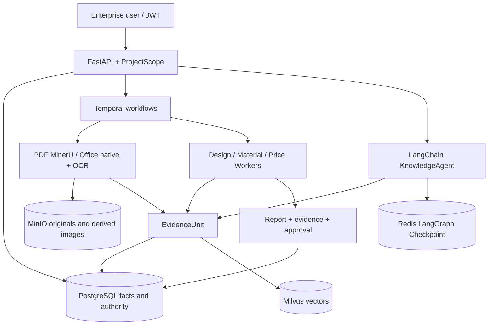

# Architecture

## Runtime

Local mode uses SQLite, local files, Fake model/embedding, and an in-process LangGraph saver. Full mode uses PostgreSQL, Redis, MinIO, Milvus, cloud models, and optional Temporal workers.

## Identity And Classification

The initial deployment has one tenant but all user, project, document, memory, review, and Agent run rows retain `tenant_id` or `project_id`. Admin, design engineer, material/procurement, and reviewer roles are checked server-side. Request-body `user_id` is deprecated and ignored.

Documents are `public`, `internal`, or `restricted`. Cloud Agent calls are rejected when selected project/package data is not public. The model never chooses permissions.

## Storage

| Component | Responsibility |
|---|---|
| PostgreSQL | identities, projects, documents, normalized facts, Evidence metadata, reports, memory authority, budget, Agent runs |
| Redis | LangGraph checkpoint with 24-hour sliding TTL, token-bucket rate limit |
| MinIO | immutable originals under content hash/version and derived images under image hash |
| Milvus | document EvidenceUnit and confirmed memory vectors |
| Temporal | durable parsing, batch import, review, retry, recovery, Signal, Query, Cancellation |

PostgreSQL writes document chunks before Milvus indexing but does not expose the document as indexed until Milvus succeeds. A vector failure leaves `index_failed` for compensating retry.

## Document Pipeline

- PDF: MinerU `auto/text/ocr` in Full parser mode; basic parser is only an explicit Local profile.
- DOCX: paragraphs, heading path, tables, embedded raster images, paragraph/image location.
- XLSX: sheet/cell content, anchored images, sheet/cell/image location.
- SmartArt, OLE, macros, and semantic chart understanding are out of scope.

Every EvidenceUnit has a stable ID, document/version, page or Office location, source kind, OCR flag, text SHA, processing status, and optional derived-image SHA.

## Retrieval And Agents

KnowledgeAgent retrieves project-scoped documents plus shared case/material/price facts. Full document retrieval combines PostgreSQL lexical/normalized fields and Milvus with weighted RRF, then optionally calls qwen3-rerank for Top-8. Results preserve backend ranks, page/location, date, and version.

PackageReviewWorkflow deterministically invokes DesignReviewAgent, MaterialReviewAgent, and PriceReviewAgent. Each Worker receives only its evidence map and one read-only evidence tool. ReportComposer is deterministic application logic, not a fourth business Agent. Invalid evidence IDs, truncated output, or invalid schemas fail the activity.

Long inputs are split by EvidenceUnit token estimates and reduced by worker. Every selected unit is represented in processed/skipped lists. Memory is provided only as context and cannot support citations.

## Workflow And Concurrency

- `document-parse`: single-document parsing/OCR/indexing; Worker concurrency 1.
- `agent-review`: three review Workers and composition; Worker concurrency 3.
- `maintenance`: batch progress, approval persistence, budget compensation.
- orchestration queue: workflow tasks and child workflow scheduling.

Document identity is `project + SHA-256 + business version`; Workflow IDs are deterministic. Document state acquisition uses a conditional PostgreSQL update. Review decisions use status plus lock version. Token budget is reserved in a locked project transaction before model calls and settled from actual usage.

## Observability

OpenTelemetry spans cover Agent invocation, retrieval, reranking, and workflow activities. `agent_runs` and `agent_steps` store only provider, model, operation, Token counts, latency, finish reason, status, and error type. Prompt, evidence text, output text, secrets, and hidden reasoning are not stored by observability code.
