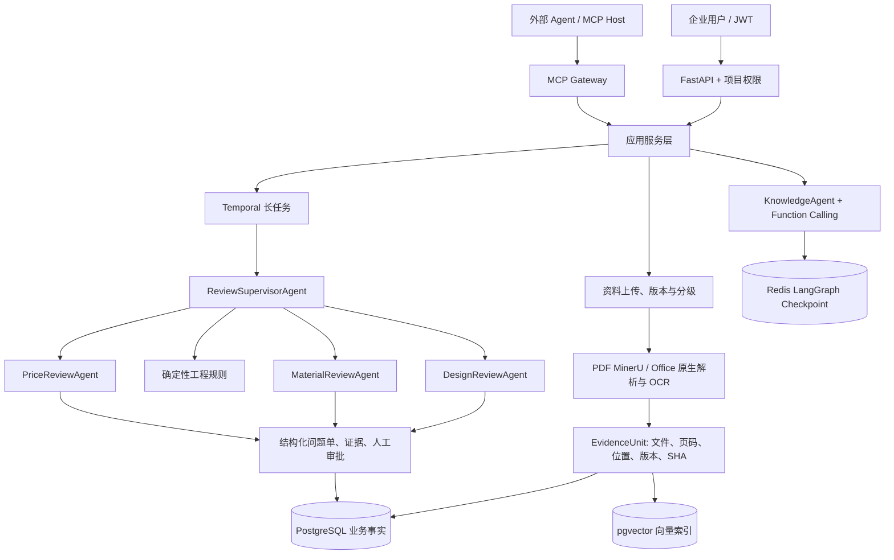

# 架构说明

## 主链路

本地模式使用 SQLite、文件目录和 Fake 模型；Full 模式使用 PostgreSQL/pgvector、Redis、MinIO、云端模型和 Temporal。

## 存储职责

| 组件 | 职责 |
|---|---|
| PostgreSQL | 用户、项目、文档元数据、Evidence、报告、问题单、预算、运行摘要和长期记忆权威记录 |
| pgvector | PostgreSQL 内的 Evidence 与已确认长期记忆向量索引，使用 cosine distance 与 HNSW 索引 |
| Redis | LangGraph 24 小时会话 Checkpoint、接口令牌桶和热点缓存 |
| MinIO | 按文件内容哈希与版本保存原件，按图片哈希保存派生 OCR 图片 |
| Temporal | 文档解析、批量导入、资料包审查、重试、恢复、查询、审批、退回和取消 |

PostgreSQL 先写入 Evidence，再写入同库中可重建的 pgvector 索引；索引成功后资料才会成为 `indexed`。向量失败必须保留 `index_failed`，不能把半完成资料暴露给检索。

## 应用服务与工具边界

FastAPI 与 MCP 共同调用 `ProjectAuthorizationService`、`KnowledgeQueryService` 和 `PackageReviewApplicationService`。协议层不直接实现权限、检索、预算或 Temporal 操作。

KnowledgeAgent 通过 Function Calling 选择四个工具：`search_project_documents`、`query_material_specs`、`query_price_records`、`get_document_evidence`。Principal 与 ProjectScope 由运行时注入，模型不能传入身份，也不会先执行一次应用层检索再重复调用综合检索工具。

MCP Streamable HTTP 提供五个查询工具和四个需要 Scope、幂等键及 Elicitation 的工作流工具；stdio 只提供查询工具。MCP 首版只返回 `public` 资料，不上传、删除、改价或修改问题单，也不参与内部多 Agent 调度。

## 文档与权限

- Full 模式下 PDF 强制使用 MinerU `auto/text/ocr`；`basic` 只用于本地 Fake 开发。
- DOCX 提取段落、标题路径、表格和嵌图位置；XLSX 提取工作表、单元格和锚定图片位置。
- 每个 EvidenceUnit 保留稳定 ID、文档/版本、页码或 Office 定位、解析类型、OCR 标记、文本 SHA 和处理状态。
- 资料分为 `public/internal/restricted`。云端模型只能处理 `public` 资料，服务端而不是模型决定权限。

## 审查与问题单

`ReviewSupervisorAgent` 使用 LangChain `create_agent` 生成 JSON 审查计划，只能从 `design/material/price` 固定白名单选择 Worker。`full` 模式固定执行三个领域，`focused` 模式才允许 Supervisor 选择子集。它没有工具、Shell、任意公网、文件写入、权限或数据库写入能力。

Evidence 在审查阶段采用多标签路由：跨领域片段可以同时进入多个 Worker，无明确领域特征的片段作为共享 Evidence；首次 Worker 并行结束后由 Coverage Gate 检查 `processed/skipped` 状态，未被任何 Worker 处理的 Evidence 最多二次分发一轮。仍未覆盖时生成 `evidence_coverage_gap` 并进入人工复核。`focused` 只在已选领域内补审，`full` 覆盖三个领域。

在 Worker 前后执行确定性工程规则：资料完整性、版本一致性、膜材厚度冲突、设计型号与规格资料对齐、价格币种/面积单位规范化和日期可比性。LLM 负责解释非结构化材料和补充问题，不能修改事实。

每个问题单包含：问题编号、领域、类型、严重级别、实际值、预期值、建议、处理状态、Evidence ID，以及文件名、页码/位置和版本。审核人通过乐观锁处理单条问题，避免并发覆盖。

`DesignReviewAgent` 审查结构形式、场景、节点和设计版本；`MaterialReviewAgent` 审查型号、规格、厚度、重量、性能、单位和版本；`PriceReviewAgent` 审查历史价格的币种、单位、区域、日期、来源和可比性。三类结果统一汇总为带 Evidence 的结构化审查报告。

Prompt Catalog 固定为 `knowledge/v1`、`review-supervisor/v1`、`design-review/v1`、`material-review/v1`、`price-review/v1`。Agent Run 保存名称、版本和 SHA，不保存完整 Prompt、Evidence 正文或隐藏思维链。

## 工作流与观测

- `document-parse`：单份资料解析、OCR 和索引，解析 Worker 并发 1。
- `agent-review`：Supervisor、领域 Worker 和报告合并，Worker 并发 3。
- `maintenance`：批次进度、审批持久化和预算补偿。

文档身份为 `项目 + SHA-256 + 业务版本`；重复提交复用既有文档/工作流。Full 模式使用 PostgreSQL 行锁预留预算，本地模式使用按项目异步锁保持相同语义。审查决定和问题单处理都使用 `lock_version`。

OpenTelemetry 与 `agent_runs/agent_steps` 只保存模型、工具、Token、延迟、结束原因和错误类型，不保存 Prompt、全文证据、模型正文、密钥或隐藏推理。
