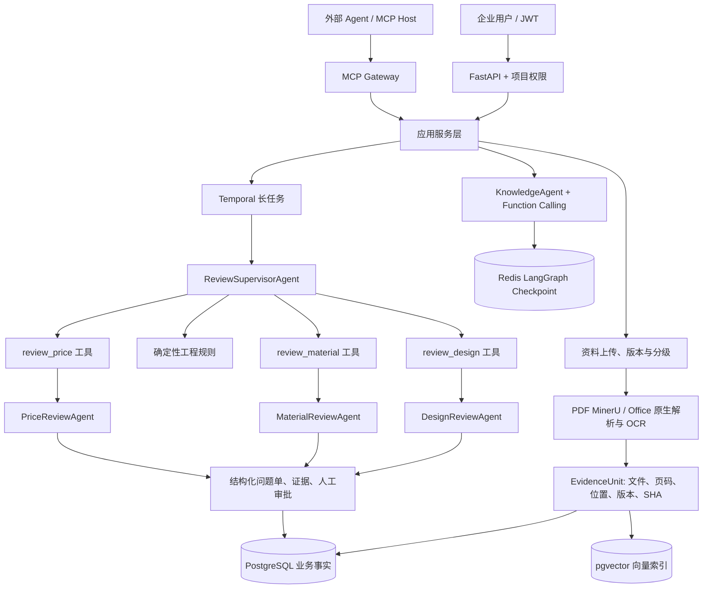

# 架构说明

当前实测以 [current-validation.md](current-validation.md) 为准。以下 Full 组件图描述代码设计，不表示本轮实际启动了全部服务。

## 主链路

本地模式使用SQLite、文件目录，可显式选择Fake/API模型及Temporal；当前演示为Local/Fake配真实Temporal开发Server。Full存储使用PostgreSQL/pgvector、Redis和MinIO，模型是否可用由端点及资料分级决定。

## 存储职责

| 组件 | 职责 |
|---|---|
| PostgreSQL | 用户、项目、文档元数据、Evidence、报告、问题单、预算、运行摘要和长期记忆权威记录 |
| pgvector | PostgreSQL 内的 Evidence 与已确认长期记忆向量索引，使用 cosine distance 与 HNSW 索引 |
| Redis | LangGraph 24 小时会话 Checkpoint、接口令牌桶和热点缓存 |
| MinIO | 按文件内容哈希与版本保存原件，按图片哈希保存派生 OCR 图片 |
| Temporal | 文档解析、批量导入、资料包审查、重试、恢复、查询、审批、退回和取消 |

PostgreSQL 先写入 Evidence，再写入同库中可重建的 pgvector 索引；索引成功后资料才会成为 `indexed`。向量失败必须保留 `index_failed`，不能把半完成资料暴露给检索。

## 应用服务与工具边界

FastAPI 与 MCP 共同调用 `ProjectAuthorizationService`、`KnowledgeQueryService` 和 `PackageReviewApplicationService`。协议层不直接实现权限、检索、预算或 Temporal 操作。

KnowledgeAgent 通过 Function Calling 选择四个工具：`search_project_documents`、`query_material_specs`、`query_price_records`、`get_document_evidence`。Principal 与 ProjectScope 由运行时注入，模型不能传入身份，也不会先执行一次应用层检索再重复调用综合检索工具。

MCP Streamable HTTP 提供五个查询工具和四个需要 Scope、幂等键及 Elicitation 的工作流工具；stdio 只提供查询工具。MCP 首版只返回 `public` 资料，不上传、删除、改价或修改问题单，也不参与内部多 Agent 调度。

## 文档与权限

- Full模式PDF强制使用MinerU auto/text/ocr；basic用于Local开发/合成回归，不能冒充MinerU验收。
- DOCX 提取段落、标题路径、表格和嵌图位置；XLSX 提取工作表、单元格和锚定图片位置。
- 每个 EvidenceUnit 保留稳定 ID、文档/版本、页码或 Office 定位、解析类型、OCR 标记、文本 SHA 和处理状态。
- 资料分为 `public/internal/restricted`。云端模型只能处理 `public` 资料，服务端而不是模型决定权限。

## 审查与问题单

2026-11-02 复现副本新增了 `DomainAgentTools`：在线 `PackageReviewService.run` 先制定计划，再由带工具的 LangChain Supervisor 调用 `review_design/review_material/review_price`。每个工具在服务端闭包内绑定已授权的 Evidence 和记忆，并调用对应领域 Agent；同一请求内重复调用复用结果。工具 Schema 不接受身份、项目或文档 ID。最终报告从实际工具输出构建，Supervisor 文本不能替代领域结果。

本地 Fake 模式显式使用脚本模型产生 Tool Calls，实际运行 LangChain 工具分发；确定性规则检查全包，领域工具不伪造模型发现或Token。API 模式使用配置的聊天模型执行工具选择和领域审查，失败不降级为 Fake。旧协议曾出现21/24通过、2误报、1结构失败。2026-11-02已将模型输出与报告字段拆分，增加引文校验与比较门禁；新协议记录每条额外阻断发现，结果见当前验证。

Temporal保留计划Activity和三个独立领域Activity，领域级独立重试；review_worker_activity也通过同一个领域工具执行。Workflow固定并行调度，LLM仅放Activity。真实开发Server已验证Worker强杀/恢复、审批离线提交、取消及5份本次历史重放，业务存储SQLite、模型Fake；不外推生产故障切换或旧历史迁移。

`full`计划由业务策略直接选择三个领域，不调用规划模型；`focused`才使用受限LangChain `create_agent`从`design/material/price`白名单选子集。工具调度仍由Supervisor执行，领域输出必须全部到齐。计划阶段不提供工具；后续在线调度阶段仅提供已绑定资料范围的领域 Agent 工具，不提供 Shell、任意公网、文件写入、权限或数据库写入能力。

Evidence 在审查阶段采用多标签路由：跨领域片段可以同时进入多个 Worker，无明确领域特征的片段作为共享 Evidence。首次调用后逐领域核对各自应处理的 `processed/skipped` 集合，不能由其他领域的 processed 抵消本领域漏审；未报告状态不自动算处理，最多补审一轮。仍有缺口则生成 `evidence_coverage_gap` 并进入人工复核。`focused` 只在已选领域内补审，`full` 覆盖三个领域。

在 Worker 前后执行作用域明确的规则：独立资料完整性、相同文件编号有效版次、同型号/适用版本的名义厚度与单位归一、设计引用与适用规格对齐、价格地区/税/币种和历史日期可比性。缺失适用性转人工，独立文件版次不同不报冲突。规则对复杂表格和产品命名仍有限，详见业务范围。LLM补充发现仍会误报，引用ID合法不能代替语义审查。

每个问题单包含编号、领域、类型、严重级别、实际/预期值、建议、处理状态与证据定位。领域归属、编号、定位和状态由服务端控制；worker选择错误、不可见/未处理引用均拒绝。审核人用乐观锁事务处理问题、批准或退回，未处理阻断问题不能批准。忽略/退回要原因，终态禁止修改；当前审计事件在usage JSON内。

`DesignReviewAgent` 审查结构形式、场景、节点和设计版本；`MaterialReviewAgent` 审查型号、规格、厚度、重量、性能、单位和版本；`PriceReviewAgent` 审查历史价格的币种、单位、区域、日期、来源和可比性。三类结果统一汇总为带 Evidence 的结构化审查报告。

Prompt Catalog 包含 `knowledge/v1`、`review-supervisor/v1`、`review-delegator/v1`、`design-review/v1`、`material-review/v1`、`price-review/v1`。`review-supervisor` 是计划阶段，`review-delegator` 是在线工具调度阶段。Agent Run 保存名称、版本和 SHA，不保存完整 Prompt、Evidence 正文或隐藏思维链。

## 工作流与观测

- `document-parse`：单份资料解析、OCR 和索引，解析 Worker 并发 1。
- `agent-review`：Supervisor、领域 Worker 和报告合并，Worker 并发 3。
- `maintenance`：批次进度、审批持久化和预算补偿。

文档身份为 `项目 + SHA-256 + 业务版本`；重复提交复用既有文档/工作流。Full 模式使用 PostgreSQL 行锁预留预算，本地模式使用按项目异步锁保持相同语义。审查决定和问题单处理都使用 `lock_version`。

OpenTelemetry 与 `agent_runs/agent_steps` 只保存模型、工具、Token、延迟、结束原因和错误类型，不保存 Prompt、全文证据、模型正文、密钥或隐藏推理。

## 简历范围补充实现（2026-11-02）

- 模型只返回`ModelWorkerReview`；引用ID和逐字引文均校验，领域、文件定位、版本、问题ID和人工状态由服务端生成。厚度/文件版次/价格比较提议经确定性规则验证；材料引用缺失仅在全包检查。其他模型提议降为需人工核查线索，不作为确定工程冲突。缺少规则支持的提议仍可能漏检，未声称通用蕴含验证。
- `document_business_metadata`保存声明型号、适用版本、文档类型、生效区间、声明人和依据；声明采用文档版本CAS。它是用户声明，非模型抽取后自动确认的事实。`DocumentSearchFilters`贯通REST、Function Calling、MCP；两个召回通道在RRF前应用同样硬条件。词项计分和Top-N移入参数化SQL，仍是substring计分，不是BM25或中文全文索引。已有复合索引服务于硬条件，未证明词项通道的大规模性能。
- 新Temporal提交在开始前将已授权证据正文、文档与片段SHA和解析元信息冻结为`review_manifests`；四个阶段读取同一快照，不把正文加入Workflow输入。云调用前重查当前分级，避免后来升级保密的资料继续发送。旧Workflow输入没有manifest标识时保留旧读取路径，不声称历史任务已迁移。
- 审批在同一事务保存带command_id/actor/reason/expected_version的决定并进入`decision_pending`，禁止继续处理问题。Workflow通过Activity读取，最长每15秒轮询，Signal仅唤醒，不携带权威决定；重复消费返回相同回执。机器报告只发布一次，cancelled/failed后迟到结果不复活任务。取消与已提交决定竞争时，已提交决定优先。
- 迁移0014为业务声明、0015为审查快照、0016为document_ingest_claims。隔离SQLite升/降/再升已通过；PostgreSQL迁移未本轮验收。Workflow命令序列变化可能影响旧历史，演示使用新v2队列/数据库；本次5份真实历史可重放，不说明旧生产历史兼容。

## 解析执行认领与围栏

document_ingest_claims以document_id为主键，记录workflow_id/run_id/activity_id组合执行身份和attempt。事务先锁文档行；同一执行严格递增attempt才能接管遗留indexing，其他执行或旧attempt拒绝。片段替换、向量替换、失败状态与最终indexed提交前都验证当前认领。旧尝试即使后来返回也不能覆盖新结果；IngestOwnershipLost不可重试。无需另加任务队列，Temporal仍管理Heartbeat超时和Activity重派。

资料业务元数据由页面及REST声明，记录来源说明与actor，CAS使用文档lock_version。页面检索与问答/MCP复用DocumentSearchFilters。当前单文档声明单主要型号；它不是PLM或自动事实确认系统。
