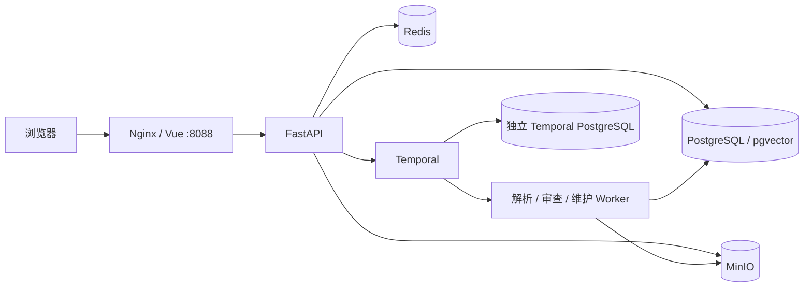

# Docker Compose 部署与验收

更新：2026-11-03。交付目标是单机部署包与可执行验收流程。本机 Docker Linux Engine 未运行，因此目前只有配置解析、启动门禁测试和前端构建记录，**没有本轮容器构建/完整栈成功记录**。真实语义质量、MinerU 和生产恢复的边界见[当前验证](current-validation.md)。

## 部署内容



`deploy/compose.yaml` 是部署入口，与根目录旧的基础设施开发 Compose 分开。包含独立迁移容器、API、Worker、静态前端、带持久卷的基础设施，以及可选 MCP 和验收容器。默认仅 Web 绑定宿主机 `127.0.0.1:8088`；数据库、Redis、MinIO、Temporal 不开放宿主端口。前端 REST/SSE 统一走 Nginx 同源 `/api/`，不会请求访问者电脑的 8080 端口。

基础镜像默认选择 **Full 存储 + Fake 模型 + 真实 Temporal**。Fake 使用独立 `demo-hash-1024` 向量名称；它用于验证数据库、权限、过滤、融合与任务流程，不能评价语义召回、模型准确率或 Reranker 效果。

建议先在独立 Linux x86_64 主机或 Docker Desktop Linux 模式验收。试跑规划可从 4 CPU / 8 GB RAM / 40 GB 可用磁盘开始；这是资源预算，未经本项目负载测试，首次编译 MinIO 可能需要更多内存。需要 Docker Engine、Compose v2+、Python 3.10+（主机上只用于生成配置），以及拉取镜像、npm/Python/Go 包和官方源码的网络。

## 首次启动

以下命令均从仓库根目录执行，Linux shell 与 PowerShell 均支持。PowerShell 可将 `python3` 替换为本机 Python 命令。

```bash
python3 scripts/init_deployment.py
docker compose --env-file deploy/.env -f deploy/compose.yaml config --quiet
docker compose --env-file deploy/.env -f deploy/compose.yaml up -d --build
docker compose --env-file deploy/.env -f deploy/compose.yaml ps -a
docker compose --env-file deploy/.env -f deploy/compose.yaml logs --tail 100 migrate api worker
```

初始化为数据库、Redis、MinIO、JWT 和管理员生成不同的随机值，Linux 文件权限为 600；已有 `deploy/.env` 不会被覆盖。管理员用户名默认 `admin`，密码在该文件的 `BOOTSTRAP_ADMIN_PASSWORD`，不要使用本机开发演示的 `admin-change-me`。修改此变量不会自动重置已创建用户的密码。

启动顺序为 PostgreSQL/Redis 就绪 → `migrate` 执行 `alembic upgrade head` → API 初始化业务库和对象桶 → Worker/Web。入口脚本还会有限等待 MinIO 与 Temporal namespace 可用；默认密码、未鉴权、非 1024 维等错误会在启动前失败。不要同时启动多个迁移容器。

浏览器访问 `http://127.0.0.1:8088`。部署在远端时，可先建立 SSH 隧道：

```bash
ssh -L 8088:127.0.0.1:8088 your-user@your-server
```

如需公网访问，应在同机 HTTPS 反向代理后接入当前回环端口，配置域名、证书和访问限制后再开放入口；本包没有自动创建域名或证书。

MinIO 镜像从固定官方源码 release `RELEASE.2025-09-07T16-13-09Z` 多阶段构建，并校验提交 `07c3a429bfed433e49018cb0f78a52145d4bedeb`，保留 LICENSE/CREDITS。准备时旧预编译地址无法可靠拉取，因此没有依赖该地址。首次构建较慢，Go 编译并行数限制为 2。所有镜像使用明确版本标签，但尚未锁定 digest，Python 传递依赖仍由范围求解；首次成功验收后应保存实际镜像 digest 与依赖清单。

## 验收并保留结果

```bash
docker compose --env-file deploy/.env -f deploy/compose.yaml --profile validation run --rm smoke
docker compose --env-file deploy/.env -f deploy/compose.yaml --profile validation run --rm --no-deps --entrypoint python smoke -c "from pathlib import Path; print(Path('/app/data/runtime/deployment/latest.json').read_text())"
```

验收脚本通过真实 HTTP 登录创建独立合成项目，上传三份 TXT，并检查：

- Temporal 提交和解析结束、持久化执行认领；MinIO 原件存在。
- PostgreSQL 安装 vector 扩展，实际写入 1024 维记录，HNSW cosine 索引存在。
- 两通道都带项目/分级/型号/版次/业务日期条件；`PTFE-5020` 与旧 R1 不混入 `PTFE-502/R2`。
- REST 返回 PostgreSQL 与 pgvector 的召回轨迹和加权 RRF 标记；无匹配型号返回空。
- 三领域审查产生领域结果，经版本锁退回并由 Temporal 消费到终态。
- 真实依赖探测、Nginx SPA 路由与同源 API 鉴权。

每次运行的安全摘要保存到 `validation-results` 命名卷；包含时间、源码 SHA、模型模式、阶段和失败类型，不保存密钥或模型正文。失败会返回非零退出码，仍留下记录。运行会新增合成项目，不会清空原有数据。HNSW **存在**不代表查询计划实际采用它，更不代表吞吐已测。

基础镜像没有 MinerU 时，整体依赖健康为 `degraded`，摘要中 `pdf_ocr_available=false`；TXT 链路可以通过。这是明确的能力缺口，不能称完整 PDF 生产验收。

## 接真实 Embedding、聊天模型和 Reranker

编辑 `deploy/.env`：

```dotenv
MODEL_MODE=api
MODEL_PROVIDER=gateway
GATEWAY_API_BASE=https://your-approved-gateway/v1
GATEWAY_API_KEY=your-key
GATEWAY_MODEL=your-chat-model
REVIEW_API_BASE=https://your-approved-gateway/v1
REVIEW_API_KEY=your-key
REVIEW_MODEL=your-tool-calling-chat-model
EMBEDDING_PROVIDER=embedding
EMBEDDING_API_BASE=https://your-approved-embedding/v1
EMBEDDING_API_KEY=your-key
EMBEDDING_MODEL=actual-1024-dimensional-model
EMBEDDING_DIMENSIONS=1024
RERANKER_ENABLED=true
RERANKER_API_BASE=https://your-approved-reranker/v1/rerank
RERANKER_API_KEY=your-key
RERANKER_MODEL=your-reranker-model
```

示例域名和 key 需替换，不是可用服务。`RERANKER_API_BASE` 是**完整 POST 端点**，代码不会自动添加路径；应替换为供应商实际的 `/rerank` 或 `/reranks` 地址，并核对 `results` / `output.results` 响应格式。不配置就保持 false。云服务仅允许公开资料，内部/受限资料要使用获准的本地 Provider。Compose 容器里的 `127.0.0.1` 是容器自身；本机模型地址应使用可达的 Docker 网络服务名或主机网关。

当前迁移固定 `vector(1024)`；其他维度需先写 schema 迁移并重建索引，不能只改环境变量。切换模型必须使用新名称，停止接收任务、等旧任务排空后维护重建，禁止新旧 Worker 混用配置：

```bash
docker compose --env-file deploy/.env -f deploy/compose.yaml stop web worker api
docker compose --env-file deploy/.env -f deploy/compose.yaml run --rm --no-deps --entrypoint python api scripts/reindex_full_embeddings.py --project-id YOUR_PROJECT_ID
docker compose --env-file deploy/.env -f deploy/compose.yaml up -d api worker web
docker compose --env-file deploy/.env -f deploy/compose.yaml --profile validation run --rm smoke
```

每个实际项目单独重建；确认命令无失败后再开放入口。模型同名但内容/维度变更同样需要迁移，不要复用 `demo-hash-*`。API 请求失败会重试后报错，不会切回 Fake。

检索质量实验在真实 API/Embedding/Reranker 配置后单独运行（会产生调用费用）：

```bash
docker compose --env-file deploy/.env -f deploy/compose.yaml run --name membrane-retrieval-eval --no-deps --entrypoint python api scripts/run_business_retrieval_eval.py --mode full-api
docker cp membrane-retrieval-eval:/app/data/eval/results ./deployment-eval-results
docker rm membrane-retrieval-eval
```

输出在该次容器内 `data/eval/results/`；上述命令导出后才移除容器，失败结果同样保留。详见[评测协议](evaluation-protocol.md)。部署 smoke 的三个文档不能用于估计 Recall/MRR。已有 119 文档/30 查询是合成开发集；真实 Embedding 403 的旧记录仍保留，简历历史数字没有被这些测试证明。

## PDF / Office 图片 OCR

基础容器支持 TXT/Markdown、无图片 Office 原生提取。`PARSER_MODE=mineru` 保留严格模式；不存在的可执行文件处理 PDF/OCR 时显式失败。安装方式需要按 MinerU 的 CPU/GPU、模型缓存与授权环境构建扩展镜像，再将 `APP_IMAGE` 指向它，并把 `MINERU_EXECUTABLE` 设置成**容器内**路径。`MINERU_API_URL` 只是现有 CLI 的参数，不能替代 CLI 安装。

不要未经验证就给出统一的 MinerU 安装命令；先在扩展镜像里运行 `mineru --help`，再用实际 PDF/扫描页/Office 图片运行现有格式验收，保留解析器、OCR、定位和失败记录。它不属于本次已通过项。

## MCP、停机、备份与升级

```bash
docker compose --env-file deploy/.env -f deploy/compose.yaml --profile mcp up -d mcp
docker compose --env-file deploy/.env -f deploy/compose.yaml stop
docker compose --env-file deploy/.env -f deploy/compose.yaml down
```

MCP 仅回环绑定 8090，Host/Origin 使用本地允许列表；远端使用隧道。`MCP_ISSUER_URL`/`MCP_RESOURCE_SERVER_URL` 应与客户端可达地址一致。普通 `down` 保留命名卷，**不要加 `-v`，除非明确要销毁全部数据**。

备份范围包括业务 PostgreSQL、MinIO 原件、Temporal PostgreSQL（含 visibility 库）、Redis，以及独立安全保管的 `.env`。维护窗口先排空任务并停止 API/Worker，做数据库逻辑备份及静止对象卷备份；恢复到隔离项目验证文档哈希、证据、报告和工作流后再切换。不要只备份可重建向量表或容器可写层。

升级先保存旧镜像和备份，再迁移、启动、运行 smoke；改变 Workflow 命令序列还须对目标历史 replay，并采用 Worker 版本/队列迁移策略。本包使用独立 `membrane-deploy-v2*`队列，不消费本机demo-v2/v3队列；本次未做生产旧历史升级或备份恢复演练。

## PostgreSQL 与 pgvector 的面试表述

型号、适用版次、生效区间是显式业务约束，在词项 SQL 和向量 SQL 中先过滤，再合并候选。PostgreSQL 词项通道目前用参数化 substring 计分与 Top-N，**不是 BM25**；pgvector 用 cosine 检索，两个列表按 `weight/(60+rank)` 做 RRF，随后可选 Reranker 返回带 Evidence 定位的候选。结构化条件解决适用性，向量解决表达差异，重排改善候选次序；不存在可用 Embedding 时不能宣称语义效果。

## 新角色与上下文开关

部署模板包含ROLE_MODEL_ROUTING_ENABLED、STRONG_MODEL_API_BASE/API_KEY、STRONG_MODEL、LIGHT_MODEL_API_BASE/API_KEY、LIGHT_MODEL。填写两组完整配置后启用；Supervisor/Review共用STRONG，检索/材料共用LIGHT。不完整时启动门禁报错。默认仍为Fake，不产生付费模型调用。项目问答/Embedding另保留原GATEWAY/EMBEDDING配置，不能因角色路由填好就认为整个RAG服务可用。

CONTEXTUAL_RETRIEVAL_ENABLED默认false。启用metadata-v1前完成文档向量重建；新旧命名空间隔离，旧向量不混入。新工作流队列为membrane-deploy-v2-*；升级已有部署必须排空旧任务或使用独立部署/卷，不能把新Worker直接接管旧历史。原始厂商PDF及全文派生MD不随部署包分发，可按来源清单在获准环境重取；下载后仍需人工确认项目适用性。
