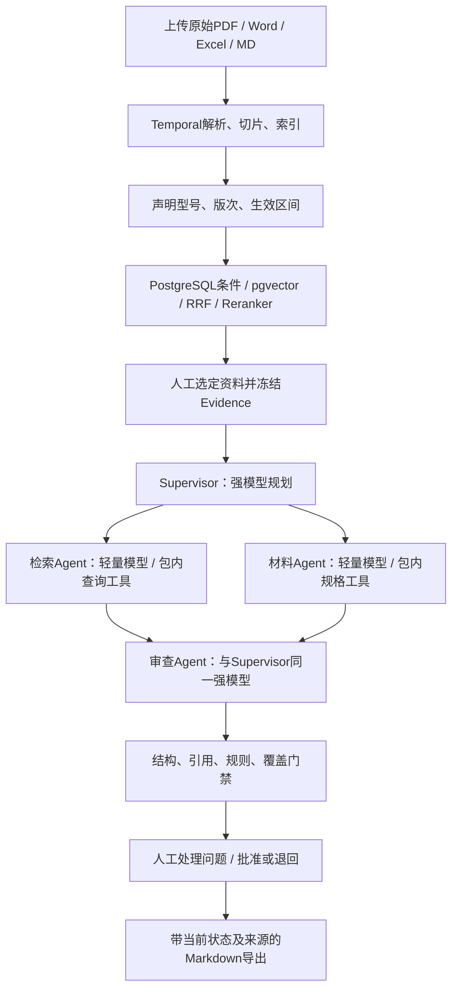

# 本轮方案、代码对应与面试口径

更新：2026-11-03。本文件区分当前复现代码、已完成验收和后续计划。原实习材料中的个人贡献及内部指标，需要由历史记录支持；本次新增代码不能追认为实习期间交付。

## 从提供的面试 MD 中采纳什么

参考资料：`01-Agent开发实习.md`，只读使用，原件没有修改。

| 参考内容 | 采用方式 | 当前代码/边界 |
|---|---|---|
| Q01/Q07：检索、材料、审查分工及依赖 | 检索和材料先并行取证，综合审查等待两路完成 | [领域工具](../src/agents/subagent_tools.py)、[Temporal](../src/workflows/temporal_definitions.py) |
| 开场05—09/Q28：单位在适配中丢失 | 工具逐字返回参数和单位；0.65 kg/㎡与650 g/㎡确定性归一比较，缺单位转人工 | [材料面密度规则](../src/domain/material_mass.py)、[测试](../test/test_role_routing_and_markdown.py) |
| Q18：原文→解析→召回→融合→上下文逐层排查 | 原文正文、来源、上下文前缀和结果分开；保留失败及中间排序 | [检索服务](../src/infrastructure/retrieval.py)、[评测脚本](../scripts/run_business_retrieval_eval.py) |
| Q21：优先RAG，微调用于稳定行为 | 当前不训练模型；先完成正确工具调用和证据链 | 训练数据、训练作业、LoRA权重和GPU推理部署均未实现 |
| Q34—43：活动边界、幂等、迟到结果和恢复 | 沿用执行/attempt围栏、证据快照、持久审批命令、版本锁和真实故障测试 | [运行手册](operator-runbook.md) |

不直接采用的说法：把本地复现数字写成历史内部样本结果；将工程联调示例当成实际经历；声称已生成合规安装方案或自动完成规范审查；将MCP说成内部Agent的必经通信层；把所有步骤画成完全并行。

MD中提及的5张RTX 4090、9B/4B角色配置、512/64 Token切片配置和中文全文检索路线不能直接作为当前代码事实。这里没有GPU推理服务，切片与词项实现应按源码回答；历史公司环境和个人职责仍需本人原始经历支撑。

## 一个可演示的完整业务

设计工程师上传项目要求、材料规格及已有安装说明；采购价格仅在任务涉及历史成本时选入。上传后发起解析任务，等待索引完成，再声明型号、适用版次、生效日期和声明依据。用户通过条件检索确认资料与Evidence位置，选定本次审查包。

提交审查时冻结证据，Supervisor按目标规划：检索Agent核对出处与相关片段，材料Agent查询包内规格并核验参数；两路结束后审查Agent重新读取原始Evidence，检查缺项、引用及跨文档差异。规则、引用、结构化输出和逐领域覆盖检查完成后，审核人查看原文并处理问题，通过版本锁批准或退回。

普通设计/规格包不需要采购报价。价格作为业务查询工具与可选检查保留，不再作为第三个Agent。没有提供适用规范时，系统不能凭模型记忆生成规范条款或给出合规结论。当前不生成施工草稿或进行结构安全计算。



这是有依赖的协作。简历“领域Agent并行审查”可以在面试时解释为前置取证并发、依赖满足后综合审查。如果需要一句更严谨的表述，可仅将其调整为“领域Agent按任务依赖并行协作”，无需更改整段项目叙述。

## 三个Agent的输入、输出与权限

| 角色 | 模型配置 | 工具/职责 | 结果约束 |
|---|---|---|---|
| Supervisor | STRONG | API模式下制定计划；在线流程按阶段调用子Agent工具 | full不得漏掉三个角色；选择review时补齐前置角色 |
| RetrievalAgent | LIGHT | `search_frozen_evidence`查包内来源、型号与版次 | 输出选中Evidence及处理覆盖，禁止生成工程问题 |
| MaterialAgent | LIGHT | `query_frozen_material_specs`查包内规格，核验参数/单位/适用版本 | 数值不能脱离单位、材料身份和原文 |
| ReviewAgent | STRONG | 读取全包原文与受限上游摘要，检查跨文档问题 | 上游摘要只是线索；发现仍需逐字原文引用和规则门禁 |

三个子Agent分别封装为`review_retrieval`、`review_material`、`review_review`工具。工具schema只接收关注点，身份、项目与Evidence范围由服务端闭包决定。重复调用在同一次请求中复用已完成结果；工具没执行，Supervisor不能只说“完成”来生成报告。

**两种检索范围要讲清楚。** 项目资料发现走已有PostgreSQL/pgvector检索服务，可通过页面、KnowledgeAgent Tool Calling或MCP访问；审查中的RetrievalAgent只查本次冻结包，使用明确标识的`snapshot_lexical`工具。它不会在长任务中把网上资料或项目新版本自动混入审查证据。需要补证则选入新资料后重新提交。当前不能声称每次审查子Agent内部都运行pgvector。

Temporal中LLM和I/O在Activity内。Supervisor计划Activity完成后，由确定性Workflow并行调度检索/材料Activity，再调度审查Activity；每个领域Activity仍通过相同工具边界执行。同步在线路径由LangChain Supervisor进行阶段化Tool Calling。二者共享领域逻辑，但不能把Workflow固定调度描述成LLM自由调度。

## 强弱模型怎么接

`.env.example`及`deploy/.env.example`已有以下字段。用户后续填模型名与获准端点，不在日志、Git或文档中放密钥。

```dotenv
ROLE_MODEL_ROUTING_ENABLED=true
STRONG_MODEL_API_BASE=https://your-strong-endpoint/v1
STRONG_MODEL_API_KEY=
STRONG_MODEL=
LIGHT_MODEL_API_BASE=https://your-light-endpoint/v1
LIGHT_MODEL_API_KEY=
LIGHT_MODEL=
```

Supervisor与Review读取同一组STRONG配置；Retrieval与Material读取同一组LIGHT配置。API模式开启路由后，任何一组缺字段即失败，不回退为Fake或另一组模型。关闭开关时保留原REVIEW配置兼容；Fake演示始终显式为Fake。角色usage记录实际模型、Provider、耗时和Token，Temporal运行轨迹也按该角色记录模型。

强模型用于规划与跨文档判断，轻量模型用于较明确的查询与参数整理。这是待实测的成本假设，尚不能宣称降低了多少成本或质量没有下降。模型服务需要支持对应的Tool Calling与JSON输出。本轮只完成路由/工具契约，未使用新强弱模型组合跑真实模型质量测试。

## Contextual Retrieval怎么补，哪些没有照搬

参考用户提供的智谱“上下文增强技术报告”：`https://docs.bigmodel.cn/cn/guide/tools/knowledge/contextual`。该页面是技术说明，不是项目已经接通的知识库API。阅读日期为2026-11-03。

当前实现低成本的`metadata-v1`：向量输入增加文件名、章节、工作表、位置和上传版本，词项检索可增加章节/工作表/位置匹配；最终返回原始正文。开关为`CONTEXTUAL_RETRIEVAL_ENABLED`，默认关闭；没有新建另一套托管知识库。

尚未实现LLM生成切片摘要、指代消解或摘要缓存，不能称完整复刻厂商上下文增强。先验证可追溯元信息的作用，再用同一冻结集合比较摘要方案。用户声明的型号/适用版次仍作硬过滤，不因摘要生成而成为被确认的事实。

启用前缀后，文档向量模型命名空间加入`:ctx-metadata-v1`。旧向量不会混入当前查询，须用重建脚本或重新索引；原始Evidence正文及哈希不变。切换开关前应停相关写入并完成重建，避免部分资料暂时只在词项通道可见。该版本不改数据库表结构。

检索算法现状：明确型号/日期/版次由参数化SQL硬过滤；词项通道是substring计分，**不是BM25**；Full模式pgvector使用cosine/HNSW；两路以`sum(weight/(60+rank))`融合，当前词项权重1、向量1.3是待验证启发式；Reranker对有限候选重新排序。不得把索引存在说成实际采用ANN执行计划或性能达标。

评测入口支持`--contextual off|on`。同一集合、同一过滤、相同30候选及文档去重Top10，保存分层Recall、MRR、失败及越界。原有TXT开发集没有完整章节信号，本轮开关前后Recall均为0.869565，3条语义改写仍全漏召回。没有改善就保留这个结果，不据此声称增强有效。

## Markdown保留什么

原始PDF/Office与哈希保留；Evidence正文、页码/Office位置作为权威。Markdown是可重新生成的派生视图，便于调试、阅读及交付，不能重建原件版式，也不能代替扫描页OCR、表格关系和图片。

资料页可下载`GET /api/v1/documents/{id}/markdown`，包含每个Evidence的ID、位置及正文哈希；报告页可下载`GET /api/v1/package-reviews/{id}/markdown`，包含生成时正文、当前问题处理状态和来源。下载经现有JWT/项目授权，不通过静态公开目录提供。源码生成的报告不能自动当作原始资料重新索引，否则会形成循环佐证。

## 前后端怎样联调

1. 前端先获取有权项目，上传multipart，再提交索引。Temporal受理返回业务ID/Workflow ID，页面用GET查询权威状态；SSE仅提示进度。
2. 型号、适用版次和日期必须由带依据的声明提交；PUT携带expected_lock_version。409要求重新加载，禁止覆盖别人的修改。
3. 条件查询返回实际过滤条件、Evidence ID、文件、位置和原文。工具、REST、MCP复用应用服务，不能各自实现一套过滤。
4. 提交审查后前端展示queued/running/awaiting_approval/decision_pending及终态。下载Markdown使用带Token的HTTP请求，失败显示真实错误。
5. 审核先处理阻断问题，再用报告版本锁提交决定。决定先持久化，Signal只唤醒；浏览器关闭不影响后台执行。报告生成和人工状态不互相覆盖。

复现“单位丢失”时，固定同一材料，分别核对规格源、工具返回及Agent输入；验证等值、不同值、缺单位、错型号、错适用版次。这里的0.65/650是合成工程用例，不能描述成已被证明发生过的实习故障。

## 算法、微调与模型部署如何回答

当前涉及Embedding、cosine相似度、HNSW、RRF、神经网络Reranker、上下文元信息增强、Decimal单位归一、证据引用校验和任务幂等。LangChain、MCP、Temporal是应用/协议/编排组件，不能全称为自研算法。

当前没有微调。资料持续更新、必须按项目授权并回查版本与原文，因此优先RAG。若有足够独立样本证明小模型经常选错工具或不能遵循结构，再评估SFT/LoRA；需准备脱敏训练集，按项目/文档家族划分训练、开发、独立测试，和未微调基线比较工具成功率、误报、成本。训练结果不替代RAG和权限。

当前调用兼容接口，不包含GPU推理服务或模型权重部署。Compose是应用和数据组件部署包；“把模型API接入容器应用”与“部署大模型推理服务”要分开回答。模型名、显存、吞吐、量化、微调提升都不能凭方案写成完成成果。

## 真实资料与落地验收

本轮从已核验的Birdair官方资料目录补充两份历史公开材料，来源、哈希和少量事实记录于[清单](../data/manifests/public-references-v1.json)。ETFE为2012-01-10资料，PVC/PVDF为2012年资料；不是当前项目的适用规格。PTFE目录请求失败同样留档。PDF及全文Markdown仅放忽略的本机runtime目录，不进入Git/部署ZIP。

已目视核对ETFE的薄膜厚度与面密度、PVC/PVDF的总厚度和涂层厚度区别；自动检查正文、页码、哈希与MD导出。此验收不证明复杂表格字段全部关联正确。现有规则对厂商实际型号及双语表格覆盖仍有限，不能把合成PTFE-502与真实Précontraint 502当同种材料。

落地还需四层验收：本地业务/权限/故障回归；真实PostgreSQL/pgvector、MinIO、Redis、Temporal整栈；选定强弱模型与真实Embedding/Reranker对照；业务人员独立标签与实际流程试用。当前Docker Engine及真实Embedding尚有环境缺口，不能将部署包写成生产上线。

## 一段可据代码回答的介绍

“这个项目把工程资料查找、材料核验和人工复核串起来。前端提交资料后，Temporal负责解析与索引；检索用明确型号、版次和业务日期过滤，再结合词项和向量召回，经RRF及重排组织候选。审查阶段先冻结选定证据，Supervisor组织检索和材料Agent并行取证，再由审查Agent核验跨文档问题。子Agent封装成工具，权限和资料范围由后端绑定。模型返回结构化发现及引文，程序校验后生成问题单，由审核人用版本锁处理和批准。我的本地复现重点验证了工具交接、任务恢复和证据追溯；真实模型与完整部署的验证范围另有记录。”

介绍实习时，个人负责范围仍以真实经历为准。用户简历写“海绿荫膜结构有限公司”，参考MD写“上海绿荫膜结构有限公司”，正式投递前需核对公司法定名称，不能从本复现推定哪一个正确。

简历四条技术主线不需要扩成技术名词清单。能丰富的地方是讲清一条业务链、两处交接、一个真实故障窗口，以及带分母的验证方法。“60条内部样本、Recall≥90%、MRR相对提升30%”仍须历史原始记录；本轮合成数据不能补证该数字。
