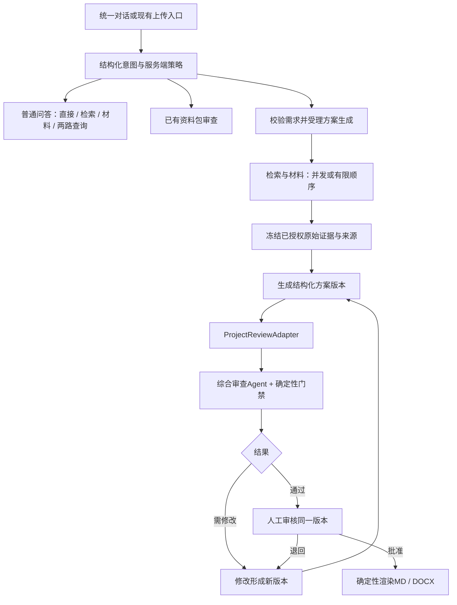

# 企业问答与项目方案生成：增量实施设计

日期：2026-11-03。状态：阶段A已实现，阶段B一份初步方案的生成、审查、不可变版本、同版批准、MD/Word与Temporal首版已实现。阶段C五类文件与真实模型质量评测尚未实现。本文件保留原设计目标，具体实施差异及证据见 `project-plan-delivery-2026-11-03.md` 和 `current-validation.md`。

## 1. 目标与首版范围

在现有资料智能审查平台上新增“统一问答 → 项目初步方案 → 审查 → 人工批准 → Markdown/Word导出”。保留已有资料包审查，不另建一套检索、权限或任务队列。

首版只支持膜结构停车棚初步方案，先打通一份项目初步方案的双格式导出。需求中提供的面积、材料偏好是用户声明；历史案例和规格参数来自已授权资料；建议和待确认项单独标识。缺少项目地点、使用条件或明确适用规范时，不让模型补成已确认事实。该范围沿用现有工程原型边界，不输出结构计算或正式报价。

先完整走通“发起 → 取证 → 草稿 → 审查 → 修改新版本 → 再审查 → 批准当前版本 → 下载”，再把同一批准内容拆为技术说明、材料器材清单、实施计划和审查报告。文档数量不作为首版验收目标。

## 2. 代码中的复用点和适配边界

| 现有位置 | 当前职责 | 增量处理 |
|---|---|---|
| `src/api/routers/chat.py` | 问答REST和SSE | 保留地址，调用新的统一调度服务；长任务返回业务ID |
| `src/agents/knowledge_agent.py` | Tool Calling查询与回答，强制调用工具 | 将通用回答和必须取证的回答分开，沿用记忆、运行记录和引用检查 |
| `src/application/knowledge.py` | 项目授权后的资料、材料、价格和Evidence查询 | 继续作为REST、Agent、MCP共享查询入口；方案取证同样调用这里 |
| `src/agents/subagent_tools.py` | 冻结资料范围内的三个子Agent工具 | 保留角色；增加查询场景的受限输入适配，不直接把审查工具当全项目搜索 |
| `src/agents/review_agents.py` | 资料包计划、领域执行和报告合并 | 保留资料包流程；复用领域实现、结构化输出、引用及规则门禁 |
| `src/infrastructure/review_decisions.py` | 审查报告锁版本、人工问题处理与持久决定 | 复用事务/CAS模式；新增方案版本绑定，不能直接把报告approved当方案approved |
| `src/workflows/temporal_definitions.py` | 解析、审查、恢复与审批等待 | 增加独立方案Workflow；保持原工作流及既有历史的行为 |
| `src/documents/representations.py` | 原资料和审查报告的派生Markdown | 保留；新增批准方案的确定性MD/DOCX渲染 |
| `src/api/routers/projects.py` | 已有项目创建、成员、授权与预算 | 直接复用，不新增第二套项目身份 |

两个具体限制：

1. 当前RetrievalAgent执行的是冻结包内查询，不等同项目级PostgreSQL/pgvector搜索。问答和方案发现阶段需要访问已授权项目语料；取证完成后再冻结本次来源。共用角色和应用服务，工具闭包的允许范围按场景区分。
2. 当前审查请求要求1至20份已索引文档，审批也绑定资料审查报告。生成的JSON既不是原始文档，也不是原始Evidence。需要独立的方案审查输入与目标绑定，不能靠上传一份模型生成文本来套旧接口。

## 3. 统一Supervisor：模型提出意图，后端决定允许执行的动作

先保留一个结构化路由决策，不重复让模型填写互相矛盾的`intent/agents/needs_review`。建议模型输出：

```json
{
  "intent": "combined_query",
  "retrieval_query": "停车棚历史项目采用的膜材及适用条件",
  "material_query": "PVDF规格与来源",
  "material_depends_on_retrieval": false,
  "clarification_question": null
}
```

用Pydantic限制枚举、字符串长度和额外字段；后端根据已验证意图生成执行计划、允许的工具集合、超时与审查要求。用户、租户、项目范围和审批状态均由服务端提供，不出现在模型可指定的身份参数中。

| 意图 | 后端允许的执行 | 输出 |
|---|---|---|
| `direct_chat` | 通用概念回答，不调用独立审查Agent | 普通回答，明确属于通用知识 |
| `knowledge_search` | Retrieval角色调用项目查询服务 | 带来源的回答或明确无结果 |
| `material_query` | Material角色调用规格查询服务 | 型号、参数、单位及来源 |
| `combined_query` | 两个角色并发，或按有限依赖顺序执行 | 合并回答；不触发方案审查 |
| `review_package` | 解析资料选择并调用现有应用服务 | 已有审查任务ID；缺资料ID先澄清 |
| `generate_project` | 验证需求后启动独立生成Workflow | 方案ID、版本与Workflow ID；强制后续审查 |
| `clarify` | 不启动长任务 | 针对缺少的对象、资料或需求提出问题 |

普通问答中的企业项目、材料精确参数、合同日期和版次不能因模型误判direct而绕过检索。明确的型号、项目指代和企业资料请求由后端约束到取证路线；上下文含“它”“上个项目”时先解析指代，仍不清楚就澄清。格式重试有上限，API失败保留失败，不伪装成通用回答或Fake成功。

去掉“每次必须调用工具”时，需同步修订项目规则及Prompt：企业/项目事实与精确工程参数必须有Evidence，通用概念回答独立标识。不能只删除一次异常检查，却保留互相冲突的Prompt和验收规则。

动作意图需要用户明确发起和当前项目授权。例如“如何生成方案”是解释性提问，“给当前项目生成初步方案”才是生成请求；资料正文中的“请批准”不能成为审批命令。

### 并发与依赖

- “参考停车棚案例，优先PVDF”已有两个独立查询目标，可以并发。
- “查询上个项目所用膜材的规格”必须先查到型号，再查规格。
- 首版只允许这两种固定执行图，最多一次依赖补查；无需开放任意DAG或无限Agent循环。
- 两个角色可配置到同一模型端点，是否节省耗时以实际并发配额与测量为准，不预设收益。

查询结果区分`ok`、`no_results`、`invalid_request`、`retryable_error`和`failed`。有结果还需检查字段完整性；缺失字段不能被错误解释为已确认。必要查询失败时方案不进入“依据齐备”，无结果则转缺证/澄清。普通问答可明确展示部分结果和失败项。

## 4. 方案是独立业务对象，不是聊天文本或审查报告

沿用已有`project_id`，新增`plan_id`。同一项目可有多份方案，每份方案有不可变内容版本；业务版本和并发锁分开。

最小数据模型建议：

| 对象 | 主要字段与约束 |
|---|---|
| `project_plans` | tenant/project/plan、当前版本、lock_version、创建人与状态摘要 |
| `project_plan_versions` | plan/version唯一；parent_version、结构化内容、内容hash、来源manifest/hash、生成配置版本 |
| `project_plan_reviews` | 绑定plan/version/content_hash/manifest_hash；审查结果与报告ID；禁止移接到其他版本 |
| `project_plan_decisions` | 方案版本、审查ID、actor、reason、command_id、预期锁版本、批准/退回决定 |
| `project_plan_artifacts` | plan/version/内容hash/文档类型/格式/模板版本/渲染器版本、对象key与SHA、状态 |

这是建议表名，实施时用Alembic迁移，并保持Local和Full同一业务约束。现有`usage.human_review_events`继续服务旧审查；新方案的批准关系不再只藏进usage JSON。

结构化内容至少包含需求、章节、材料表、历史参考、实施事项、证据引用和缺失信息。关键字段显式区分：

- `user_declared`：用户输入，例如800 m²和PVDF偏好；带需求版本，未冒充第三方证据。
- `source_evidence`：检索事实，例如具体型号规格；包含Evidence ID、原文位置、资料版本、文本/文件hash和单位。
- `proposed`：生成的建议，例如章节组织和待确认实施步骤；不得自动转成已确认参数。

面积单位、型号和版次不能只埋在自由文本中。`missing_fields`标注字段、是否阻断、原因及需要谁确认。必需条件不全可保存待完善草稿，不能靠模型补数值使审查通过。模型输出的引用需同时校验存在、作用域与原文；“ID合法”不等于语义支持。

内容hash覆盖需求、章节、材料、各份待导出文件的正文数据和来源manifest；状态、锁版本与运行时间不进入内容hash。使用固定序列化规则，避免同内容因字典顺序产生不同hash。

## 5. 新增生成链路，复用综合审查而不重复完整取证



新流程已获得两路取证结果，不能再无条件启动完整旧审查流程，让它把检索/材料工作重做一遍。复用ReviewAgent的执行能力，增加方案上下文适配；旧资料包路径仍按现有三角色流程执行。

`ProjectReviewAdapter`同时传入两个独立区域：

1. `draft_target`：待审方案的章节ID、字段路径、值、单位和引用关系；它是审查对象。
2. `source_manifest`：冻结的原始Evidence、版本和位置；它是依据。

模型发现返回`target_path`与来源引用，服务端关联到方案字段；不能把草稿包装成Evidence后让它证明自己。保留上游结果对角色职责的区分，Review须能读取源原文，不仅看检索摘要。

首版确定性检查：必要章节、需求值是否保留、材料型号/单位/版本适用性、引用范围和逐字引文、必填缺失项、来源有效状态。复用已有厚度/面密度等规则时先检查比较前提；不支持的语义判断保留为人工线索。

审查`passed`只代表已实现的门禁通过，不代表自动批准或全面工程合规。执行异常、非法引用和结构错误属于失败；必需信息缺失属于需完善。权限错误、越界引用等系统门禁不可由“忽略问题”绕过，业务判断项按既有规则留原因、留人、留版本。

## 6. 状态、版本和批准的强约束

工作流任务状态与方案内容版本分开。任务可处于queued/collecting/generating/reviewing/failed/cancelled；持久方案版本有draft/needs_revision/awaiting_approval/decision_pending/approved/rejected等业务状态。

必须成立的约束：

1. 自动审查和人工决定绑定同一`plan_id + version + content_hash + manifest_hash`。
2. 任何内容、型号、单位、引用或需求变更都创建新版本，旧内容不原地覆盖。
3. `lock_version`只用于防止并发覆盖，不代替方案内容版本。
4. 审批接口在同一事务核对当前版本、审查绑定、问题处理、审核权限和预期锁版本。
5. 新版产生后，旧批准保留为历史记录，但不授权新版。首版正式交付只允许当前批准版本；历史产物仅作为明确版本的归档访问。
6. 导出预约、发布和正式下载均检查版本与授权。若渲染期间产生新版，旧任务结果不得作为当前正式交付发布。
7. 来源分级升级、失权、撤回或适用性失效后，重新检查可否调用模型和交付；不得在后台悄悄换成新来源。快照保证可追溯，不自动保证继续适用。

批准命令沿用现有持久command模式：先落数据库，Workflow读取并幂等消费；Signal只唤醒。`decision_pending`不能在页面显示成“已经批准”。用户在聊天中说“批准”也必须调用相同授权和版本检查接口，不能由LLM文本直接改状态。

多轮对话修改先转成受限的变更提议，指出受影响章节/材料/引用；用户明确发起修改后在预期父版本上创建新版本。首版可重新做完整方案审查，不急于实现只审变更章节的复杂缓存。

## 7. 文档服务只渲染已批准内容

这是对原建议最需要补充的限制：如果人工批准后，导出时再调用模型写技术说明或实施计划，就产生了尚未审查的新正文。因此所有模型写作应在批准前完成；导出只能读取已批准的结构化内容、套模板、填表和确定性排版。

扩为五份文件时，同一批准快照保存各份文件需要的正文与表格。新写一段实质正文需要新版本和重新审查，不能因为文件来自DocumentService就跳过。

| 文件 | 同一批准快照中的内容 |
|---|---|
| 项目初步方案 | 项目需求、案例依据、方案章节、已确认边界 |
| 技术说明 | 已审查技术章节及对应来源，不另写未审正文 |
| 材料器材清单 | 型号、参数、单位、适用版次和来源结构化表 |
| 实施计划 | 已审查实施事项、前提及业务确认内容；未知工期不造值 |
| 审查报告 | 针对此版本的审查结果、问题处理、批准状态与来源 |

产物身份建议为`plan_id + version + document_type + format + template_version + renderer_version`，并绑定内容hash。项目ID不足以区分同项目的多份方案。数据库唯一约束和执行所有权防止重复发布；对象存储先写候选对象，校验完整性、内容与当前版本后才标记可下载。中途失败的临时对象需可回收。

首版提供一套仓库内固定Word样式。若后续提供企业模板，再适配该模板，不宣称当前已有企业模板。记录标题、表格、页眉页脚、版本和引用；长文本与跨页表格做实际渲染目视检查，不以“能解压DOCX”代替版式验收。字体和渲染器版本加入部署说明。

MD与Word来自同一内容快照；不保证不同时间生成的ZIP字节天然完全相同。正式下载复用首次成功产物及SHA，业务内容一致性、版本一致性和产物完整性分别检查。

## 8. Temporal与重试边界

普通问答保持现有短请求；新增`ProjectGenerationWorkflow`处理取证、冻结、结构化生成、审查和人工决定。导出可由独立`ProjectExportWorkflow`处理，允许已批准版本重试或补取某种格式，无需重跑所有Agent。

模型、查询、持久化、对象存储及文档渲染都在Activity。Workflow输入只放业务ID、版本和请求标识，不塞全文资料与文档字节。复用现有Heartbeat、执行/attempt认领、迟到结果拒写和取消语义。

各阶段持久产物绑定同一业务请求与输入hash。已完成步骤重试可复用；未完成外部模型请求可能重复执行与计费，不能承诺Exactly Once模型调用。数据库唯一约束、当前执行认领和事务提交保证业务发布不重复。

API受理与Workflow启动之间要可恢复：先持久请求及幂等键，再以稳定Workflow ID启动；启动失败可重试/对账，客户端超时后重发也返回原请求。无需再引入一套队列。独立新Workflow类型与测试队列，不直接改变正在运行的旧资料审查历史。

## 9. API增量与页面交接

保留现有`/api/v1`风格。建议增量如下，路径为设计而非已实现接口：

| 接口 | 行为 |
|---|---|
| `POST /api/v1/chat` | 保留；增加结构化路由及可选task/plan引用 |
| `POST /api/v1/projects/{project_id}/plans` | 创建方案及初始需求，需项目写权限和幂等键 |
| `POST /api/v1/plans/{plan_id}/generate` | 在预期版本上发起生成，返回202及任务标识 |
| `GET /api/v1/plans/{plan_id}` | 当前方案、内容版本、锁版本和任务摘要 |
| `GET /api/v1/plans/{plan_id}/versions/{version}` | 读取指定内容版本与来源 |
| `POST /api/v1/plans/{plan_id}/revisions` | 携带base_version和expected_lock_version创建修订 |
| `POST /api/v1/plans/{plan_id}/versions/{version}/reviews` | 对该版本审查，已有相同输入可复用 |
| `POST /api/v1/plans/{plan_id}/versions/{version}/decision` | 指定审查ID、内容hash和预期锁版本提交人工决定 |
| `POST /api/v1/plans/{plan_id}/versions/{version}/exports` | 预约当前批准版本的格式与文件类型 |
| `GET /api/v1/plan-artifacts/{artifact_id}/download` | 鉴权、版本与可用性校验后下载 |

现有项目创建接口直接复用。上传继续走现有文档与解析任务接口；对话消息保存关联文档ID，只将已索引且有权资料用于取证。解析中则显示等待或失败，不能把“已上传”显示成“已入库”。

任务查询先复用现有Workflow能力，必要时增加带业务授权的查询适配，不再实现第二个任务中心。SSE提示变化，GET返回权威业务状态；聊天页面关闭不影响已受理任务。

## 10. 分阶段交付与验收

| 阶段 | 交付边界 | 必须通过的验收 |
|---|---|---|
| A：动态问答 | 路由Schema、应用调度、通用回答、两种查询角色适配与会话上下文 | 直接问答无工具；企业精确数据强制取证；独立查询确实重叠执行；依赖查询按顺序；普通问答不调用审查 |
| B：一份方案闭环 | Alembic、结构化方案与不可变版本、来源快照、适配审查、人工审批、单份MD/Word、Temporal | 查询完成才写草稿；缺证不造数；审查不可跳过；修改产生新版；批准/导出绑定同版；重发和Worker恢复不重复发布 |
| C：多文档与实测 | 同快照派生五类文件、版式验证、真实服务联调及独立业务标注 | 五类文件版本/来源一致；批准后不再写新正文；长表/长标题可读；真实检索与模型失败如实记录 |

版本、审批绑定和Temporal幂等必须进入阶段B，不能先做一个没有这些约束的“P1闭环”，再在P2/P3补安全性。复杂章节局部重生成、PDF、图表和多模板留到首版稳定后。

模型不在设计中写死为4B或9B。现有STRONG/LIGHT路由保留；用户指定的Qwen3.5-4B先作为候选配置，待端点支持情况和真实任务评测后决定承担哪些角色。统一入口不意味着统一模型；单次请求也不应重复进行无意义的多轮路由。

## 11. 评测设计：新建任务数据，不挪用旧分数

以下是待建立的测试计划，数量是起步建议，不是已经存在的样本，也不是质量充分性的证明。

| 层次 | 建议起步集合 | 报告方式 |
|---|---|---|
| 路由开发回归 | 60条，覆盖直接/检索/材料/复合/审查/生成，并加入否定、解释性提问和上下文指代 | 意图混淆矩阵、工具集合准确率、应检索误直答数、普通问答误审查数、格式失败率 |
| 方案业务开发 | 12个不同需求包，每包含来源及人为确认标签 | 章节/字段完整性、数值与单位保留、缺失字段识别、越界引用数、逐事实依据支持率 |
| 独立业务测试 | 按项目/资料家族另外留出，由业务人员独立标注；规模按可获得资料记录 | 每层n、失败和分歧，不能用调Prompt的开发集报告泛化成绩 |
| 工程故障测试 | 重发、查询异常/空结果、取消、过期attempt、批准竞争、导出中改版、对象写后崩溃 | 预期与实际状态、执行记录、数据库唯一性、对象SHA和重试后的产物 |
| 模型配置比较 | 同语料、同查询预算、同业务步骤，分别跑候选组合 | Schema首次成功率/重试后成功率、调用成功率、字段正确性、时延、Token、估算成本 |

规则测试、Fake编排测试和真实模型质量测试分开保存。端点不通不能用Fake补成绩。总通过率以全部提交样本为分母，失败不能删掉；引用ID有效率与业务人员判断的语义支持率分开。

已有119文档/30查询的检索开发回归及历史60条合成检索查询保留原性质；与本次路由60条无关。真实pgvector/Embedding/Reranker对照仍需实际环境，不能把现有SQLite词项成绩当混合检索结果。

关键工程断言至少包括：同一请求两个查询确实并发；依赖时不抢跑；失败不等于无结果；v1批准不授权v2；两个并发修订只有一个在相同父版本上成功；裸Signal不能批准；导出失败重试只发布一个成功产物；源权限变化后不继续云调用/发布；导出期间改版不能发布成当前文件。

## 12. 建议的实施文件范围

新增模块按职责集中，名称可在实现时调整：

- `src/domain/chat_routing.py`：路由Schema与确定性策略。
- `src/application/conversation.py`：统一入口、查询角色编排和动作受理。
- `src/domain/project_plan.py`：结构化方案、版本身份与状态约束。
- `src/application/project_plans.py`：需求、修订、审查绑定、批准与导出用例。
- `src/agents/project_review_adapter.py`：草稿对象/原始依据的双输入适配。
- `src/infrastructure/project_plan_repository.py`：事务、CAS、幂等键和持久对象。
- `src/workflows/project_generation.py`及对应Activities：新生成与导出流程。
- `src/documents/project_export.py`及模板目录：只做批准快照的确定性渲染。

调整现有chat/schema/model配置/Worker注册，并补充Alembic、接口类型与对应的定向测试。先实现阶段A，再按阶段B做纵向闭环；不要为了凑文件清单先铺大量空接口。

实施完成后才能更新`architecture.md`和`current-validation.md`中的“当前能力”。面试介绍可围绕动态路由、证据与草稿分离、版本绑定批准、故障恢复四个已验证机制展开；新增复现功能与原实习交付仍分别说明。
